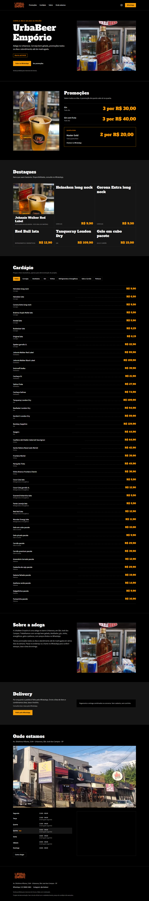

# UrbaBeer Empório — site de demonstração

Site institucional de uma página para a adega UrbaBeer Empório (Urbanova, São José dos Campos): status de abertura calculado em tempo real, promoções, cardápio e pedido pelo WhatsApp.

> **Projeto de demonstração.** Sem vínculo oficial com o estabelecimento. A marca, a logo e as fotos pertencem à UrbaBeer; todos os itens e preços do cardápio são exemplos plausíveis, claramente marcados na página. O site não é indexado (`noindex`) por não ser o site oficial.

**Deploy:** https://urbabeer.vercel.app

## Demonstração



<p align="center">
  
</p>

## Stack

- React 19 + TypeScript + Vite
- Tailwind CSS v4 (tema em `src/styles/index.css`, sem Tailwind config)
- Oxlint, Vitest, sharp (só para converter imagens)

## Como rodar

```bash
npm install
npm run dev      # desenvolvimento
npm test         # testes do utilitário de horários
npm run build    # build de produção em dist/
```

## Simular horários

Para ver a página em um horário específico, use o parâmetro `?agora=` (recurso só de demonstração, mantido no código):

```
http://localhost:5173/?agora=2026-10-27T03:00:00-03:00
```

Aceita qualquer string que `new Date()` aceite; a lógica converte para o fuso de São Paulo.

## Estrutura

```
src/
  data/        # conteúdo editável: contato, promocoes, cardapio, destaques, config (DEMO)
  sections/    # Hero, Promocoes, Destaques, Cardapio, Sobre, Delivery, OndeEstamos
  components/  # Header, Footer, WhatsAppFloat
  utils/       # horarios.ts (lógica de abertura), preco.ts, whatsapp.ts
scripts/       # checagem de rolagem horizontal e geração dos prints de docs/
```

## Decisões de projeto

- **Horário com janelas e madrugada**: dias podem abrir às 10h ou 12h e fechar depois da meia-noite (04h). O utilitário em `src/utils/horarios.ts` trata cada dia como janela [abertura, fechamento] e cobre a madrugada do dia seguinte; todos os cálculos usam o fuso de São Paulo, independente do fuso da máquina. Coberto por testes em `npm test`.
- **Conteúdo editável em `src/data`**: nada de hardcode nas seções; textos e itens ficam todos em arquivos de dados.
- **Interruptor `DEMO`** (`src/data/config.ts`): enquanto `true`, a página mostra avisos discretos de que os preços são exemplos; com `false`, os avisos somem.
- **Mobile-first**: single column no celular, layout duplo a partir de `md:`. Nenhuma rolagem horizontal em 320–1280px (checado por `scripts/checar-rolagem.mjs`).
- **Acessibilidade**: HTML semântico, link "pular para o conteúdo", menu mobile com `aria-expanded` e fechamento por Esc, foco visível, tabelas com `caption`.
- **Sem libs de UI ou de animação**: todo o estilo vem do Tailwind; sem carrosséis, animações de entrada ou gradientes.

## Qualidade

Lighthouse em mobile no build de produção:

| Métrica           | Nota |
| ----------------- | ---- |
| Performance       | 90   |
| Acessibilidade    | 100  |
| Boas práticas     | 100  |
| SEO               | 69\*  |

\* O único item que falha é `is-crawlable`, consequência deliberada do `noindex` do projeto de demonstração. Report completo em `docs/lighthouse.report.json`.

## Aprendizados

- Horários que cruzam a meia-noite quebram modelagens ingênuas de "dia + hora"; tratar cada dia como uma janela com fechamento no dia seguinte resolve, e testes de fronteira (23:59, 00:00, 04:00) pegam quase todos os erros.
- O fuso da máquina visitante não é o fuso da loja; o utilitário precisa neutralizar o offset local antes de usar `getDay()`/`setHours()`.
- Conteúdo de exemplo exige avisos honestos onde o dado faltando é promessa de preço: melhor marcar tudo como ilustrativo no próprio dado (`demo: true`) do que espalhar alertas soltos no layout.
- Lighthouse em mobile prende em detalhes invisíveis no desktop: imagens fora da dobra sem `lazy`, fonte de display sem `display=swap`, mapa do Google sempre carrega.
